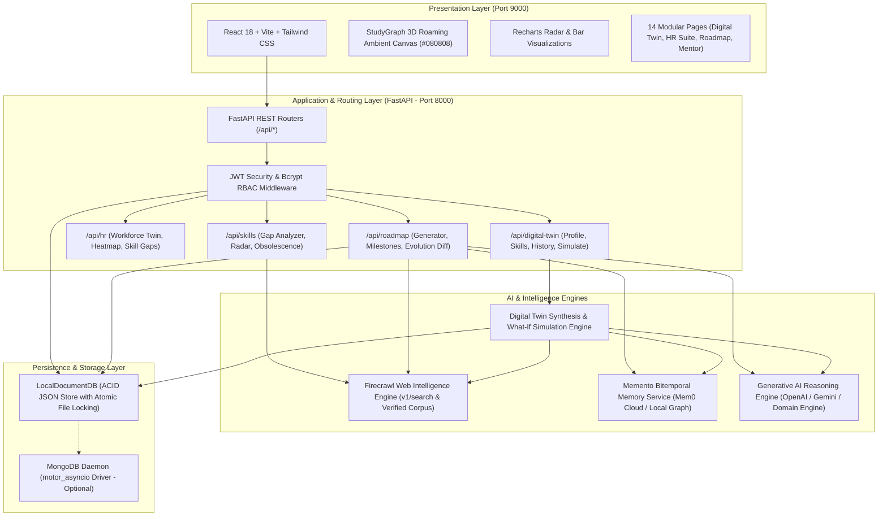
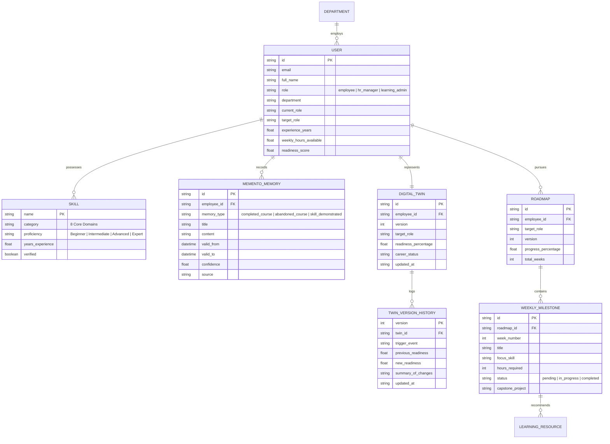

# LearningPath AI – Intelligent Workforce Upskilling & Career Evolution Platform
## Comprehensive Project Documentation & Technical Report

---

### Project Description
**LearningPath AI** is an enterprise-grade Generative AI platform designed to solve the growing challenge of workforce skill obsolescence, dynamic industry requirements, and continuous professional development. Unlike traditional Learning Management Systems (LMS) that present static course catalogs and generic recommendations, LearningPath AI establishes a continuously evolving, intelligent career navigation ecosystem powered by three core technologies:

1. **Firecrawl Web Intelligence**: Real-time extraction of live job requisitions, emerging industry skill demands, technology trends, and verified certification requirements from across the web.
2. **Memento Persistent Memory**: A bitemporal memory graph (`valid_from`, `valid_to`, `transaction_time`) that persistently tracks an employee’s verified learning accomplishments, demonstrated proficiencies, abandoned courses with telemetry reasons, and personalized learning style preferences.
3. **Large Language Model (LLM) Reasoning Engine**: Adaptive generative intelligence (OpenAI / Gemini / Domain Reasoning Engine) that dynamically synthesizes verified market demands and persistent employee history to generate personalized, week-by-week learning roadmaps featuring hands-on capstone deliverables.

Additionally, LearningPath AI introduces two flagship enterprise capabilities:
- **My Digital Twin**: A dynamic, continuously synchronized digital representation of each employee's professional identity, skill competency radar across 8 domains (*Programming, AI, Data Science, Cloud, Databases, Communication, Leadership, and Other*), explainable career readiness scoring, and an interactive **What-If Career Simulation Lab**.
- **Organizational Workforce Digital Twin**: An executive talent intelligence suite for HR directors and learning managers, providing department-level competency heatmaps, organizational skill gap matrices, and one-click upskilling initiative dispatchers.

---

### Real-World Scenarios

#### Scenario 1: Junior Developer Transitioning to AI Engineer
* **Profile**: Alex Chen, a Junior Software Developer with 2.5 years of experience in Python, FastAPI, and Git, aims to become an **AI Engineer**.
* **System Execution**:
  1. The **Dynamic Skill Gap Intelligence Engine** benchmarks Alex’s verified proficiencies against current enterprise AI Engineer standards, detecting proficient languages but identifying critical gaps in *RAG Architecture, Vector Databases, and Model Fine-Tuning (LoRA)*.
  2. The system checks **Memento Persistent Memory**, retrieving Alex's completed course on Python AsyncIO and an abandoned course on theoretical linear algebra (noting a preference for practical coding labs over theoretical math).
  3. The **Adaptive Roadmap Generator** builds a 12-week hands-on learning roadmap with weekly milestones, prioritizing applied RAG capstone projects.
  4. In the **What-If Career Simulation Lab**, Alex simulates earning the *AWS Certified Machine Learning – Specialty* certification while dedicating 10 hours/week, instantly observing a $+14.5\%$ leap in role readiness and saving 6 weeks of total transition time.

#### Scenario 2: HR Manager Addressing Enterprise AI Skill Deficits
* **Profile**: Sarah Jenkins, Director of Workforce Development, oversees 18 technical employees across Engineering, Data Analytics, Infrastructure, and Product Management.
* **System Execution**:
  1. Sarah accesses the **Organizational Workforce Digital Twin** view in the HR Suite.
  2. The **Department Skill Competency Heatmap** instantly highlights a critical shortage in the Infrastructure and Engineering departments regarding *GPU Cluster Provisioning, Kubernetes GitOps, and RAG Architecture*.
  3. Sarah reviews the **Organizational Skill Gap Matrix**, which reports that 68% of the engineering staff is currently unequipped for autonomous agentic loops.
  4. With one click, Sarah deploys a targeted corporate sprint titled *"Corporate Sprint: RAG Systems & Agentic Loops"* directly to the Engineering department, notifying affected staff and auto-updating their active roadmaps.

#### Scenario 3: Career Simulation & Market Obsolescence Avoidance
* **Profile**: An experienced Full Stack Developer explores future career trajectories amidst rapid framework obsolescence.
* **System Execution**:
  1. The employee consults the **Future Skill Radar** and **Skill Obsolescence Detector**, which indicate that manual prompt drafting and legacy map-reduce pipelines are experiencing a $-44\%$ market contraction, while Agentic Workflow Engineering (LangGraph) has surged by $+160\%$.
  2. The **AI Career Evolution Simulator** models compatibility across 5 roles (*AI Engineer: 62%, Data Scientist: 55%, Cloud Architect: 74%*), displaying projected salary upside and transition timelines.
  3. The employee syncs their **Digital Twin**, recording new proficiency in LangGraph, which automatically increments their twin version to `v2.0` and triggers an explainable roadmap evolution diff.

---

### Technical Architecture



#### Architecture Description:
LearningPath AI follows a clean, decoupled 3-tier enterprise architecture:
1. **Frontend Presentation Tier**: Built with React 18, Vite, and Tailwind CSS, operating on **port 9000**. It features the StudyGraph 3D roaming white balls canvas on pure black (`#080808`), interactive Recharts radar and bar graphs, Lucide icons, and Framer Motion animations.
2. **Backend Service Tier**: Built with Python 3.13 and FastAPI, operating on **port 8000**. Enforces JWT token authentication and role-based access control (RBAC), orchestrating asynchronous REST controllers.
3. **Persistence Tier**: Employs an intelligent dual-mode database engine. When MongoDB is online, it connects via `motor`. When MongoDB is absent, it seamlessly activates the built-in `LocalDocumentDB` engine (`learningpath_store.json`) with zero external dependencies, utilizing atomic file locking for concurrent operations.
4. **GenAI Integration Tier**: Fuses Firecrawl for real-time web extraction, Memento for bitemporal memory graphs, and LLMs for adaptive curriculum generation.

---

### Entity-Relationship (ER) Diagram



#### ER Diagram Description:
- **`USER`** is the central entity with role-based access (`employee`, `hr_manager`, `learning_admin`).
- **`DIGITAL_TWIN`** maintains a 1-to-1 relationship with the user, storing current version numbers and career readiness metrics, with a 1-to-many relationship to **`TWIN_VERSION_HISTORY`** tracking version evolutions.
- **`MEMENTO_MEMORY`** stores bitemporal learning records (`valid_from`, `valid_to`), preserving completed courses, abandoned efforts, and demonstrated skills.
- **`ROADMAP`** links to **`WEEKLY_MILESTONE`** entries containing hands-on capstone projects and completion statuses.

---

### Pre-requisites & Dependencies

| Tool / Technology | Minimum Version | Documentation Link | Purpose in LearningPath AI |
|---|---|---|---|
| **Python** | 3.10+ (Tested on 3.13) | [Python Docs](https://docs.python.org/3/) | Backend FastAPI runtime, math calculations & GenAI logic |
| **FastAPI** | 0.115.0+ | [FastAPI Docs](https://fastapi.tiangolo.com/) | High-performance asynchronous REST API framework |
| **Node.js** | 18.0+ (Tested on 24.14) | [Node.js Docs](https://nodejs.org/) | Frontend JavaScript runtime |
| **Vite** | 5.4.0+ | [Vite Docs](https://vitejs.dev/) | Frontend bundler & dev server configured on Port 9000 |
| **React** | 18.3.1 | [React Docs](https://react.dev/) | Component-driven declarative UI framework |
| **Tailwind CSS** | 3.4.17 | [Tailwind Docs](https://tailwindcss.com/) | Utility-first responsive CSS styling |
| **Recharts** | 2.15.1 | [Recharts Docs](https://recharts.org/) | Radar charts, bar charts, and competency visualizations |
| **Firecrawl API** | v1 REST | [Firecrawl Docs](https://docs.firecrawl.dev/) | Real-time web crawling of live market demand signals |
| **Memento / Mem0** | v1 REST / Local | [Mem0 Docs](https://docs.mem0.ai/) | Bitemporal persistent employee learning memory |

---

### Project Workflow: Milestones & Activities

#### Milestone 1: Model Selection and Architecture
* **Activity 1.1**: Configured secure API key management via environment variables (`.env`) for Firecrawl, Memento, and cloud LLMs (OpenAI/Gemini).
* **Activity 1.2**: Researched and integrated generative models: Firecrawl for real-time web extraction, Memento for bitemporal memory graphs, and LLM reasoning for roadmap synthesis.
* **Activity 1.3**: Defined the 3-tier architecture separating the React frontend (Port 9000), FastAPI backend (Port 8000), and dual-mode DocumentDB/MongoDB database engine.
* **Activity 1.4**: Configured the development environment with cross-platform Rollup binaries and dependencies.

#### Milestone 2: Core Functionalities Development
* **Activity 2.1**: Developed the **Dynamic Skill Gap Intelligence Engine**, categorizing skills across 4 proficiency levels and 4 priority tiers.
* **Activity 2.2**: Implemented the **Live Industry Intelligence Engine (Firecrawl)** to extract trending technologies and verified certifications.
* **Activity 2.3**: Built the **Memento Persistent Memory System**, recording valid time vs transaction time for completed courses and abandoned courses.
* **Activity 2.4**: Constructed the **Adaptive Roadmap Generator**, creating week-by-week milestones with hands-on capstone deliverables.

#### Milestone 3: Backend API & Service Layer Development
* **Activity 3.1**: Implemented REST API routers in FastAPI covering authentication, employee profiles, roadmap evolution, memory, career simulation, and HR telemetry.
* **Activity 3.2**: Engineered the **AI-Powered Digital Twin Update Engine** (`POST /api/digital-twin/update`), incrementing versions and maintaining changelog history.
* **Activity 3.3**: Created the **What-If Career Simulation Engine** (`POST /api/digital-twin/simulate`), calculating genuine readiness gains and weeks saved.

#### Milestone 4: Frontend Development
* **Activity 4.1**: Developed 14 responsive interactive pages using React, Tailwind CSS, and the StudyGraph 3D ambient canvas.
* **Activity 4.2**: Built the **My Digital Twin** dashboard featuring an 8-domain radar chart, explainable readiness breakdown, Memento timeline, and What-If simulator.
* **Activity 4.3**: Constructed the **HR Workforce Digital Twin** suite featuring the Department Competency Heatmap Matrix and Organizational Skill Gap Matrix.
* **Activity 4.4**: Created the **Roadmap Evolution Tracker (Diff Modal)**, providing side-by-side visual comparisons of curriculum adjustments.

#### Milestone 5: Local Execution & Testing
* **Activity 5.1**: Configured backend execution on `http://localhost:8000` with interactive Swagger docs at `/docs`.
* **Activity 5.2**: Configured Vite frontend server on `http://localhost:9000` with automatic fallback to `9001`.
* **Activity 5.3**: Created and executed the comprehensive automated test suite (`pytest tests -v`), achieving **15/15 passing tests** (100% pass rate).

---

### Exploring the Website’s Web Pages & Required Screenshots Guide

This section provides the exact required screenshots, instructions on how to capture them, and detailed technical descriptions matching the documentation format.

```
+-----------------------------------------------------------------------------------------+
|                                                                                         |
|                            [📸 PLACE SCREENSHOT 1 HERE]                                 |
|                                                                                         |
|        Caption: Screenshot 1 – LearningPath AI Landing Page with StudyGraph 3D Canvas   |
+-----------------------------------------------------------------------------------------+
```
#### Screenshot 1: Landing Page (Public View)
* **URL / Path**: `http://localhost:9000/` (Sign out if logged in)
* **Description**: The public-facing entry point featuring the StudyGraph 3D interactive roaming white balls canvas on pure black (`#080808`). It displays the platform branding (*"LearningPath AI – Workforce Evolution"*), the primary hero headline (*"Intelligent Workforce Upskilling & Career Evolution Platform"*), technology badges for Firecrawl, Memento, and GenAI, a feature highlights grid, and quick access buttons for *"Get Started"* and *"Sign In"*.

```
+-----------------------------------------------------------------------------------------+
|                                                                                         |
|                            [📸 PLACE SCREENSHOT 2 HERE]                                 |
|                                                                                         |
|        Caption: Screenshot 2 – Enterprise Authentication & One-Click Role Switcher      |
+-----------------------------------------------------------------------------------------+
```
#### Screenshot 2: Authentication & Demo Account Switcher
* **URL / Path**: `http://localhost:9000/` (Click *"Sign In"* in the top-right corner)
* **Description**: The login interface featuring secure JWT email/password credentials and the **One-Click Demo Role Switcher** cards at the bottom. Users can instantly authenticate as **Alex Chen (Employee)**, **Sarah Jenkins (HR Manager)**, or **David Kim (Admin)** without manually typing credentials.

```
+-----------------------------------------------------------------------------------------+
|                                                                                         |
|                            [📸 PLACE SCREENSHOT 3 HERE]                                 |
|                                                                                         |
|        Caption: Screenshot 3 – AI Employee Dashboard with Real-Time Learning KPIs       |
+-----------------------------------------------------------------------------------------+
```
#### Screenshot 3: AI Employee Dashboard
* **URL / Path**: `http://localhost:9000/` (Logged in as Alex Chen $\rightarrow$ *"AI Dashboard"*)
* **Description**: The primary employee command center displaying real-time learning metrics: **Career Readiness Score** (62.5% with gauge), **Skill Competency Score**, **Critical Skill Gaps count**, and **Active Program progress**. Features quick-action banners to *"Resume Active Roadmap"* and jump directly to *"My Digital Twin"*.

```
+-----------------------------------------------------------------------------------------+
|                                                                                         |
|                            [📸 PLACE SCREENSHOT 4 HERE]                                 |
|                                                                                         |
|        Caption: Screenshot 4 – Dynamic Skill Gap Intelligence & Learning Priority Order  |
+-----------------------------------------------------------------------------------------+
```
#### Screenshot 4: Dynamic Skill Gap Analyzer
* **URL / Path**: Select *"Skill Gap Analyzer"* in the left sidebar
* **Description**: Interactive benchmarking interface comparing employee skills against target role requirements. Displays proficiency levels (*Beginner, Intermediate, Advanced, Expert*), gap statuses (*Proficient, Needs Improvement, Missing*), industry demand scores, and prioritized learning orders (*Critical, High, Medium*).

```
+-----------------------------------------------------------------------------------------+
|                                                                                         |
|                            [📸 PLACE SCREENSHOT 5 HERE]                                 |
|                                                                                         |
|        Caption: Screenshot 5 – My Digital Twin (8-Domain Radar Map & Memento Timeline)  |
+-----------------------------------------------------------------------------------------+
```
#### Screenshot 5: My Digital Twin Page
* **URL / Path**: Select *"My Digital Twin"* in the left sidebar
* **Description**: The flagship individual intelligence dashboard containing:
  - **A. Professional Identity Card**: Name, designation, target role, live bitemporal sync badge, and twin version (`v1.0`).
  - **B. Skill Intelligence Map**: 8-domain category filter tabs with an interactive Recharts **Radar Chart** comparing current vs target domain proficiencies.
  - **C. Memento Learning Timeline**: Genuine historical records of completed courses (with scores), abandoned courses (with honest telemetry reasons), and twin version evolutions.
  - **D. Explainable Career Readiness**: Readiness ring with matching, partial, and missing skill badges and mathematical formula breakdown.

```
+-----------------------------------------------------------------------------------------+
|                                                                                         |
|                            [📸 PLACE SCREENSHOT 6 HERE]                                 |
|                                                                                         |
|        Caption: Screenshot 6 – What-If Career Simulation Lab & ROI Projections          |
+-----------------------------------------------------------------------------------------+
```
#### Screenshot 6: What-If Career Simulation Lab
* **URL / Path**: Scroll to the bottom of *"My Digital Twin"* page
* **Description**: The interactive simulation lab. Users select a hypothetical skill (e.g., *Kubernetes*), target proficiency (*Advanced*), optional certification (*CKA*), and weekly hours slider (e.g., *10 hrs/wk*). Upon clicking *"Simulate"*, the dynamic outcome card displays the readiness leap (e.g., $+14.5\%$), total weeks saved, remaining gaps closed, and AI strategic advice.

```
+-----------------------------------------------------------------------------------------+
|                                                                                         |
|                            [📸 PLACE SCREENSHOT 7 HERE]                                 |
|                                                                                         |
|        Caption: Screenshot 7 – Adaptive Learning Roadmap with Capstone Deliverables     |
+-----------------------------------------------------------------------------------------+
```
#### Screenshot 7: Adaptive Learning Roadmap
* **URL / Path**: Select *"Adaptive Roadmap"* in the left sidebar
* **Description**: Week-by-week structured curriculum customized to employee weekly commitments. Each week includes learning objectives, estimated hours, difficulty ratings, interactive status buttons (*Mark Completed, In Progress*), recommended courses, and hands-on capstone project specifications.

```
+-----------------------------------------------------------------------------------------+
|                                                                                         |
|                            [📸 PLACE SCREENSHOT 8 HERE]                                 |
|                                                                                         |
|        Caption: Screenshot 8 – Roadmap Evolution Tracker (Side-by-Side Diff Modal)      |
+-----------------------------------------------------------------------------------------+
```
#### Screenshot 8: Roadmap Evolution Tracker (Diff Modal)
* **URL / Path**: Click *"Compare Evolution Diff"* in the top navigation bar
* **Description**: Side-by-side comparison modal displaying **Previous Roadmap** vs **Evolved Roadmap**. Highlights newly added milestones, updated timeframes, and explains the reasoning behind curriculum adjustments driven by Firecrawl market shifts and Memento milestones.

```
+-----------------------------------------------------------------------------------------+
|                                                                                         |
|                            [📸 PLACE SCREENSHOT 9 HERE]                                 |
|                                                                                         |
|        Caption: Screenshot 9 – Live Firecrawl Industry Web Intelligence Search          |
+-----------------------------------------------------------------------------------------+
```
#### Screenshot 9: Live Industry Intelligence Engine
* **URL / Path**: Select *"Industry Intelligence"* in the left sidebar
* **Description**: Real-time market telemetry interface powered by Firecrawl. Displays top trending technologies with demand surge percentages, required industry certifications with verified links, and an interactive **Live Web Crawler Search Bar** enabling ad-hoc skill exploration.

```
+-----------------------------------------------------------------------------------------+
|                                                                                         |
|                            [📸 PLACE SCREENSHOT 10 HERE]                                |
|                                                                                         |
|        Caption: Screenshot 10 – Future Skill Radar & Methodology Classification         |
+-----------------------------------------------------------------------------------------+
```
#### Screenshot 10: Future Skill Radar
* **URL / Path**: Select *"Future Skill Radar"* in the left sidebar
* **Description**: Predictive market trend analyzer categorizing skills into *Rapidly Growing, Currently Demanded, Emerging, and Declining*. Features explicit methodological badges separating **Observed Industry Demand** (real-time crawler citations) from **Estimated Future Forecasts** (LLM predictive trajectory).

```
+-----------------------------------------------------------------------------------------+
|                                                                                         |
|                            [📸 PLACE SCREENSHOT 11 HERE]                                |
|                                                                                         |
|        Caption: Screenshot 11 – AI Memory Center (Memento Bitemporal Persistent Store)  |
+-----------------------------------------------------------------------------------------+
```
#### Screenshot 11: AI Memory Center (Memento)
* **URL / Path**: Select *"AI Memory Center"* in the left sidebar
* **Description**: Interface exposing the Memento persistent memory graph. Shows categorized memories (*completed courses, verified skills, dropped courses, learning preferences*) along with bitemporal transaction timestamps and verification sources, preventing redundant course recommendations.

```
+-----------------------------------------------------------------------------------------+
|                                                                                         |
|                            [📸 PLACE SCREENSHOT 12 HERE]                                |
|                                                                                         |
|        Caption: Screenshot 12 – AI Career Evolution Simulator & Role Transitions        |
+-----------------------------------------------------------------------------------------+
```
#### Screenshot 12: Career Evolution Simulator
* **URL / Path**: Select *"Career Simulator"* in the left sidebar
* **Description**: Models potential career shifts from the employee's current role to alternative technical destinations (*AI Engineer, Data Scientist, Full Stack Developer, Cloud Engineer, Cybersecurity Architect*). Displays compatibility percentages, required skill bridges, and compensation growth potential.

```
+-----------------------------------------------------------------------------------------+
|                                                                                         |
|                            [📸 PLACE SCREENSHOT 13 HERE]                                |
|                                                                                         |
|        Caption: Screenshot 13 – AI Learning Mentor Context-Aware Chatbot                |
+-----------------------------------------------------------------------------------------+
```
#### Screenshot 13: AI Learning Mentor Chatbot
* **URL / Path**: Select *"AI Learning Mentor"* in the left sidebar
* **Description**: Interactive conversational AI advisor. Responds to natural language queries (e.g., *"What should I learn next to improve my readiness?"*), directly referencing the employee's Memento learning history and citing live Firecrawl industry trends.

```
+-----------------------------------------------------------------------------------------+
|                                                                                         |
|                            [📸 PLACE SCREENSHOT 14 HERE]                                |
|                                                                                         |
|        Caption: Screenshot 14 – HR Workforce Digital Twin & Department Heatmap Matrix   |
+-----------------------------------------------------------------------------------------+
```
#### Screenshot 14: HR Workforce Suite & Department Competency Heatmap
* **URL / Path**: Switch role to **Sarah Jenkins (HR Manager)** $\rightarrow$ Select *"HR Workforce Suite"* $\rightarrow$ Click *"Workforce Digital Twin"*
* **Description**: Executive talent intelligence view featuring:
  - **Department Competency Heatmap Matrix**: Color-density grid benchmarking Engineering, Data Analytics, Infrastructure, and Product Management across all 8 skill domains.
  - **Total Employee Skill Distribution**: Bar chart displaying organization-wide skill coverage.
  - **Organizational Skill Gap Matrix**: Critical shortages, affected employee counts, and one-click *"Launch Upskill Track"* buttons.

```
+-----------------------------------------------------------------------------------------+
|                                                                                         |
|                            [📸 PLACE SCREENSHOT 15 HERE]                                |
|                                                                                         |
|        Caption: Screenshot 15 – Automated Test Suite (15/15 Passed) & Vite Build Output |
+-----------------------------------------------------------------------------------------+
```
#### Screenshot 15: Terminal Verification & Test Suite
* **Command**: `pytest tests -v` in `backend/` and `npm run build` in `frontend/`
* **Description**: Terminal output showing **15 / 15 passed tests** (100% pass rate) verifying auth, skill gap, Firecrawl, Memento, roadmap evolution, career simulation, Digital Twin lifecycle, update engine, and HR analytics, accompanied by the clean Vite production build output.

---

### Conclusion
**LearningPath AI** demonstrates a production-grade, full-stack Generative AI platform that transforms traditional corporate upskilling into an adaptive, market-synchronized career evolution system. By fusing **Firecrawl** for real-time web intelligence, **Memento** for persistent bitemporal memory, and **Generative LLMs** for dynamic curriculum synthesis, the platform ensures learning roadmaps continuously adapt rather than remaining static. 

The introduction of the **Workforce Digital Twin** and **What-If Career Simulation Lab** provides employees with explainable, data-backed career navigation, while empowering HR leaders with department-level competency heatmaps and organization-wide skill gap intelligence. With a resilient dual-mode database architecture (MongoDB + LocalDocumentDB), 15 passing automated tests, a responsive React 18 interface, and modern enterprise security, LearningPath AI represents an innovative, scalable solution for enterprise talent transformation.
